# Фаза 5 — Windows: отчёт

**Статус: в работе.** Готовы часть 1 — движок раскладки `internal/layout` и golden-тесты против GTK, — спайк S4 и первая версия драйвера Win32: `examples/hello` и `examples/form` работают под Wine обоими тулчейнами (09.10.2026). Дальше — интеграционные тесты nui под Wine, подсказки, выделяемые подписи и проверка на настоящей Windows.

## Часть 1. Движок раскладки `internal/layout`

У Win32 нет контейнеров, поэтому раскладку для него считает движок на чистом Go. Эталон поведения — nui на GTK (ADR-10), и движок обязан раскладывать **так же, до пикселя**.

| Что | Как устроено |
|---|---|
| Движок | `Measure` (снизу вверх) и `Arrange` (сверху вниз) по дереву `Node`: Box, Grid, Frame, Scroll, листья. Алгоритмы перенесены из исходников GTK 3.24 (`gtkbox.c`, `gtkgrid.c`, `gtkwidget.c`, `gtksizerequest.c`) вместе с округлениями. Около 550 строк с комментариями, без единого импорта |
| Юнит-тесты | 18 тестов на примерах, посчитанных вручную; покрытие 100 % |
| Golden-тесты | 11 случаев на текстовом языке (`internal/layout/testdata/cases`). Эталон снимает **сам драйвер nui на GTK**: случай строится из настоящих виджетов, тест берёт у GTK размеры листьев и прямоугольники всех узлов (ADR-18). Движок совпал с GTK **во всех случаях, во всех узлах, точно** — без допусков |
| Где проверяется | `TestLayoutGTK` — в обычном `make test` на любой машине с GTK: сверка идёт на шрифтах этой машины. `TestGolden` — по снимкам, без GTK, в том числе на Windows. Снимки пишет `make golden` в контейнере |

Что тесты действительно ловят ошибки, проверено мутациями. В движок по очереди вносились три правдоподобные неточности, и каждую поймал свой случай:

| Мутация движка | Кто поймал |
|---|---|
| в `distribute` обрезать отрицательный разрыв нулём | `grid-span`: колонка 171 px вместо 60 |
| не давать пустой ячейке минимум 1 px | `box-zero`: `Stretch` шириной 0 вместо 1 |
| считать `Out` вместе с отступом контейнера | `align`: VBox с `padding=5` |

### Что выяснилось о GTK (и теперь повторено в движке)

- **Колонка Grid может сжаться ниже минимума.** Ячейка на несколько колонок поднимает минимумы своих колонок больше, чем их естественные размеры. Тогда при лишнем месте `gtk_distribute_natural_allocation` сжимает такую колонку до естественного размера. В `grid-span` колонка с минимумом 171 px получает 60, а ячейка на две колонки остаётся целой. Это не ошибка теста: в коде GTK разрыв «естественный − минимальный» в этом месте не обрезается.
- **Ячейка не бывает меньше 1 px.** Пустой `Stretch` без места получает 1 px, а соседа GTK сдвигает на настоящий размер (0).
- **Отступ контейнера не входит в его allocation.** `Box.Padding` в GTK — это `border-width`: он вычитается из места виджета ещё до выравнивания. `Out` в движке устроен так же.
- **Frame = ребёнок + постоянное оформление.** У Adwaita это 1 px по бокам и снизу и 18 px сверху (заголовок). Ширина заголовка — нижняя граница ширины рамки (`Floor`).
- **Scroll в GTK по умолчанию не хочет показывать содержимое.** Без `propagate-natural-*` естественный размер `GtkScrolledWindow` — 46 × 46 (по полосам прокрутки), а layout.md, §5 обещает естественный размер ребёнка. Драйвер исправлен: `NewScroll` включает `propagate-natural-width/height`. Окно без `SetSize` теперь показывает содержимое прокрутки целиком, если хватает экрана.
- **Скрытые дети растягивание не дают.** Это проверено и в исходнике: `gtk_widget_compute_expand` для скрытого виджета всегда `FALSE`.

### Размеры

Не изменились: `hello` и `form` в TinyGo — 23 680 и 41 808 байт, в gc — 1 305 448 и 1 400 520. Движок в Linux-сборку не входит, а новый код `NewScroll` примеры не используют.

### Фотоотчёт

Снимки делает `TestLayoutGTK` с `NUI_SHOTS` (`tools/docker-run.sh make shots`). На каждом снимке — **окно GTK, поверх которого нарисовано то, что посчитал движок**: красные рамки — листья, синие — Frame и Scroll. Рамки ложатся точно по краям виджетов: значит, движок разложил так же, как GTK.

| | |
|---|---|
| 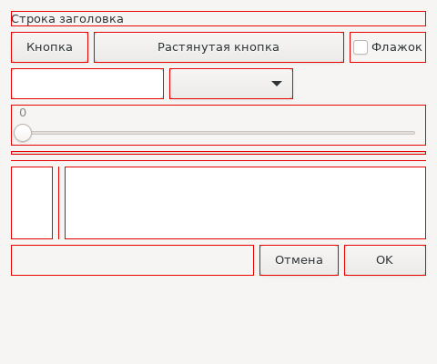 | **`widgets`** — настоящие виджеты nui: подпись, кнопки (одна растянута), флажок, поле, список, ползунок, индикатор, разделители, два TextView (слева `SetMinSize(-1, 80)`, справа `Expand`), внизу `Stretch` и «OK» с `SetMinSize(90, -1)` |
| 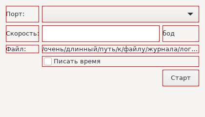 | **`grid-form`** — форма «подпись: поле», растягивается колонка 1; поле порта и путь к файлу — на две колонки, путь с многоточием |
| 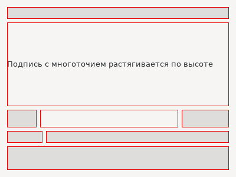 | **`box-basic`** — пример из layout.md, §8: подпись с `Expand` по высоте, `Stretch` между блоками, блок с `align=end,center`, Grid с ячейкой на две колонки |
| 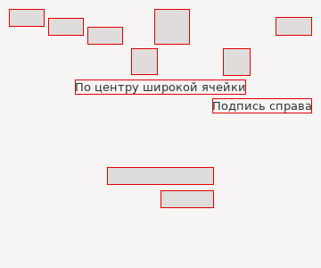 | **`align`** — Start, Center, End, Fill по обеим осям, в Box и в Grid; VBox с `Expand` и `align=center,center` занимает естественный размер в середине своей ячейки |
| 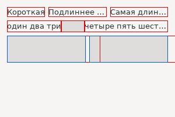 | **`box-shortfall`** — места меньше естественного: подписи с многоточием и прокрутки получают минимум плюс доли по `gtk_distribute_natural_allocation`. Содержимое прокрутки шире видимой области — его рамка уходит за край |
| 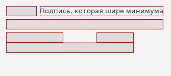 | **`grid-span`** — сверху колонка сжата ниже минимума (60 из 171 px, см. выше); снизу ячейка на три колонки без растягиваемых делит недостающее поровну |
| 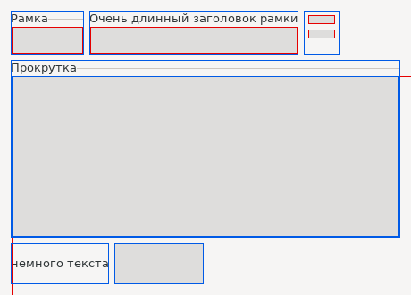 | **`frame-scroll`** — рамки: длинный заголовок задаёт ширину, рамка без заголовка; большая прокрутка, ребёнок 600 × 400 крупнее видимой области; прокрутка с подписью и прокрутка с `SetMinSize(100, -1)` |
| 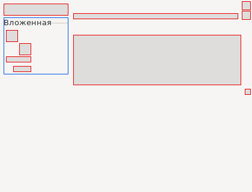 | **`nested`** — вложенность с отступами, рамка с Grid внутри, `SetMinSize` у контейнеров |
| 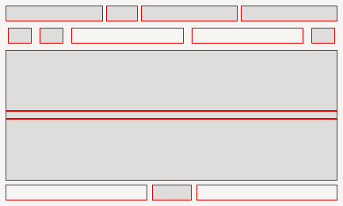 | **`box-expand`** — свободное место поровну растягиваемым, остаток по пикселю первым; скрытый ребёнок места не занимает |
| 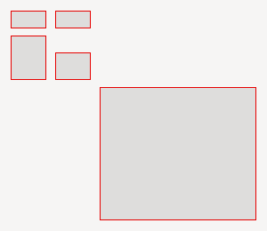 | **`grid-empty`** — пустые колонки и строки нулевые, промежутков вокруг них нет; растягиваемые строки |
| 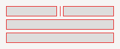 | **`box-zero`** — окно ровно по естественному размеру: `Stretch` и пустая подпись получают по 1 px |

## Часть 2. Спайк S4: hello на Win32

Подробно — в [spike/s4/RESULT.md](../../spike/s4/RESULT.md). Коротко:
- оба тулчейна кросс-собирают Win32-программу на Debian 12 (mingw-w64). Под Wine 8.0 окно открывается, нажатие кнопки приходит в WndProc на Go через `//export`, выход с кодом 0;
- **размер hello: gc — 1 365 504 байта, TinyGo — 46 080**;
- манифест (Common Controls v6, PerMonitorV2): у gc — `.syso`, у TinyGo — тот же объект через `#cgo LDFLAGS: -L. -l:rsrc.o`. Подсистема GUI у TinyGo ставится после линковки (`objcopy --subsystem windows`);
- comctl32 драйвер не импортирует, а грузит через `LoadLibraryW` (уточнение ADR-16);
- под Windows TinyGo 0.42 линкует только кооперативный планировщик `tasks`, поэтому программам с горутинами на Windows нужна сборка gc.

| | |
|---|---|
|  | **gc** с манифестом: comctl32 v6 (подсказка в поле), подпись сменил обработчик нажатия на Go |
|  | **TinyGo, 46 КБ**: то же самое |
| 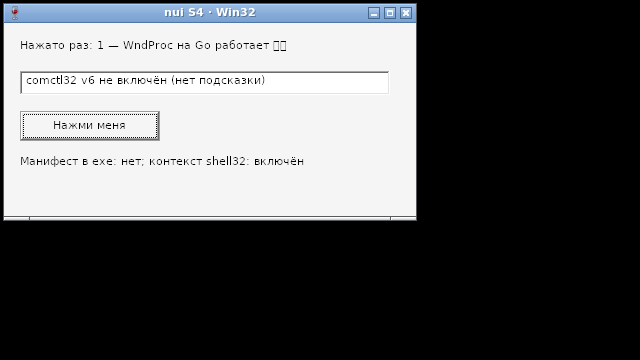 | без манифеста — для сравнения: comctl32 v5, подсказки нет |

## Часть 3. Драйвер Win32

`internal/drv/*_windows.*` реализует тот же контракт, что драйвер GTK (driver-gtk3.md, §3). Пакет nui и примеры не изменились ни на строку, кроме ресурсов Windows (`app.manifest`, `app.rc`).

| Что | Как устроено |
|---|---|
| FFI | свои прототипы `win32_windows.h` (77 функций, 169 констант, 15 структур); `make check-protos` сверяет их с `<windows.h>` mingw-w64 — пункт DoD фазы |
| Узлы | `H` — индекс в таблице драйвера. Box, Grid, Stretch — виртуальные узлы без HWND; HWND ещё не вставленного виджета живёт у скрытого «парковочного» окна и при вставке переезжает к окну или прокрутке |
| Раскладка | `internal/layout` в физических пикселях при dpi окна: отступы nui масштабируются, листья измеряются шрифтом окна (`DrawTextW`, `BCM_GETIDEALSIZE`, метрики шрифта). Пересчёт — один раз на пачку изменений (`PostMessage`), Z-порядок — по дереву, он же порядок Tab |
| Цикл | `GetMessageW`; Enter в поле с `OnEnter` перехватывается до `IsDialogMessageW`, а та даёт Tab и Enter = кнопка по умолчанию (`DM_GETDEFID`) |
| `Do`, таймеры | служебное окно `HWND_MESSAGE`: `PostMessageW` из любого потока; `SetTimer` с `ud` в `nIDEvent` |
| DPI | Per-Monitor v2: шрифты `lfMessageFont` под dpi окна, `WM_DPICHANGED` — новые шрифты, перемерить, новый прямоугольник |
| Диалоги | `TaskDialog` (через `GetProcAddress`) или `MessageBoxW`, `GetOpenFileNameW`/`GetSaveFileNameW`, `SHBrowseForFolderW`, `ShellExecuteW` |

Проверено под Wine 8.0: `make win-selftest` — hello и form, gc и TinyGo, выходят с кодом 0. Размеры:

| Пример | gc | TinyGo |
|---|---|---|
| hello | 1 459 712 | 88 064 |
| form | 1 532 416 | 101 888 |

Пока не сделано: всплывающие подсказки (`SetTooltip`), выделяемые подписи (`SetSelectable`); `Progress.SetText` на Windows не отображается по контракту (api.md, §12).

| | |
|---|---|
| 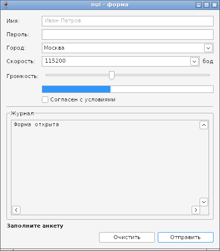 | **form, gc, Wine 8.0, 100 %.** Grid «подпись: поле» (подписи по центру по вертикали, как у GTK), подсказка «Иван Петров» в пустом поле, ComboEntry и «бод», ползунок, индикатор 40 %, флажок, разделитель, рамка «Журнал» с TextView (моноширинный, `Append`), жирная строка состояния, кнопка по умолчанию «Отправить» |
|  | **form, TinyGo (102 КБ)** — то же самое |
| 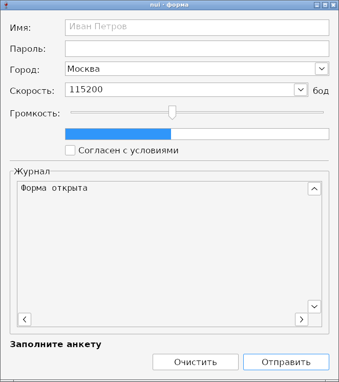 | **150 % (144 dpi).** Шрифт, отступы и окно (440 × 480 логических → 660 × 720 физических пикселей) выросли вместе |
| 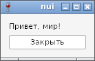 | **hello**: окно по размеру содержимого, по центру экрана |

## Дальше

Интеграционные тесты nui (`-tags gui`) под Wine — те же, что гоняются на GTK; подсказки и выделяемые подписи; проверка на настоящей Windows 10/11 (масштабы, перенос окна между мониторами) — вручную.
